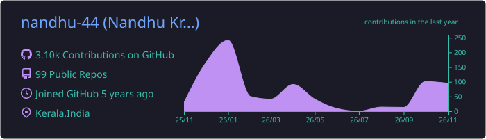

<p align="center">
  
</p>

<p align="center">
  <a href="https://nandhu-44.vercel.app">
    
  </a>
</p>

<p align="center">
  <a href="https://nandhu-44.vercel.app"></a>
  <a href="https://nandhu-44.vercel.app/contact"></a>
  <a href="https://www.linkedin.com/in/nandhukrishnana/"></a>
  <a href="https://kaggle.com/nandhu44"></a>
  <a href="https://www.geeksforgeeks.org/profile/nandhu44"></a>
  <a href="https://discord.com/users/820502577783373884"></a>
</p>

<p align="center">
  
</p>

## 👨‍💻 About Me

- 🤖 Applied AI / ML engineer working on **LLM systems, computer vision and accessible AI**
- 🎓 Computer Science student at **CUSAT**
- 🌐 More about my work and experience: **[nandhu-44.vercel.app](https://nandhu-44.vercel.app)**
- 📫 How to reach me: **[nandhu-44.vercel.app/contact](https://nandhu-44.vercel.app/contact)**

## 🚀 Featured Project

<table>
  <tr>
    <td width="96" align="center">
      <a href="https://github.com/nandhu-44/Git-Time-Machine"></a>
    </td>
    <td>
      <b><a href="https://github.com/nandhu-44/Git-Time-Machine">Git Time Machine</a></b> &middot; <code>git-tm</code><br/>
      Explore any Git repository's history in your browser: commit graph, diffs, blame and insights, and <b>time travel</b> between any two commits, forwards or backwards. One command, zero dependencies.<br/><br/>
      <a href="https://www.npmjs.com/package/git-tm"></a>
      <a href="https://www.npmjs.com/package/git-tm"></a>
      
    </td>
  </tr>
</table>

```bash
npm install -g git-tm
git tm   # run inside any repository
```

<a href="https://github.com/nandhu-44/Git-Time-Machine"></a>

## 🛠️ Tech Stack

**AI / ML**

<p>
  <br/>
  
  
  
  
</p>

**Languages**

<p>
  
</p>

**Web & Backend**

<p>
  
</p>

**Databases, Cloud & Tools**

<p>
  <br/>
  
</p>

## 📊 GitHub Stats

<p align="center">
  
  
</p>

<p align="center">
  
</p>

<p align="center">
  <picture>
    <source media="(prefers-color-scheme: dark)" srcset="./assets/github-snake-dark.svg" />
    <source media="(prefers-color-scheme: light)" srcset="./assets/github-snake.svg" />
    
  </picture>
</p>

## ☕ Support

<p>
  <a href="https://ko-fi.com/nandhu44"></a>
</p>

<p align="center">
  
</p>
